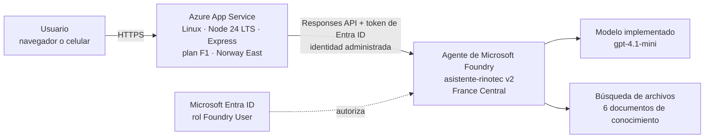
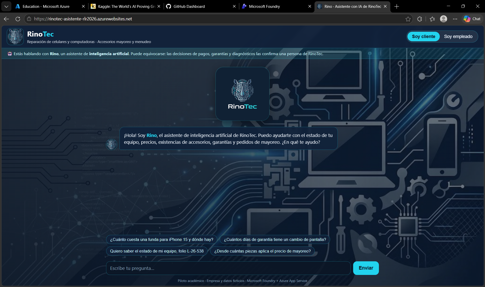
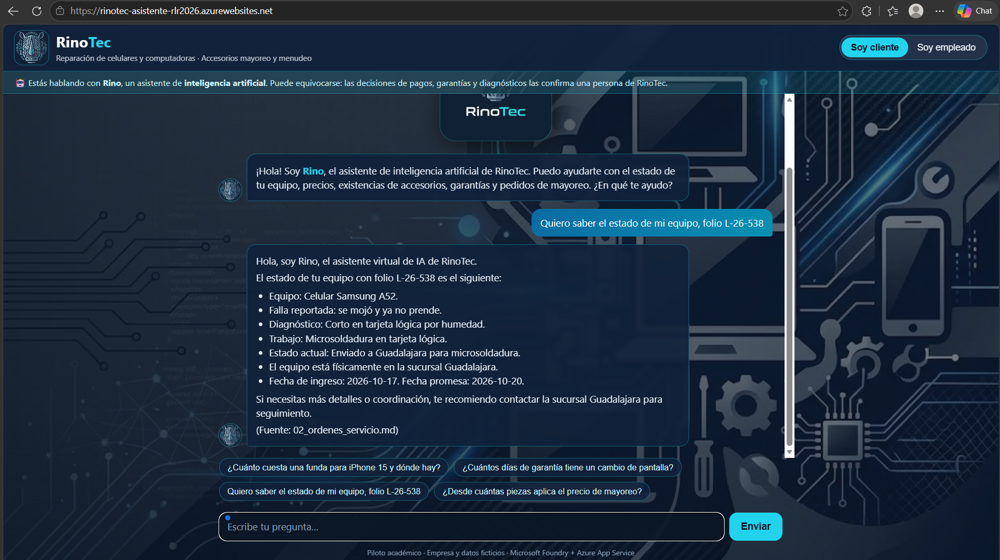
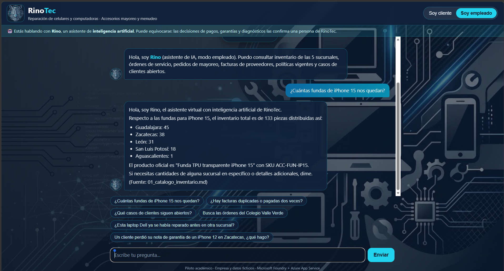
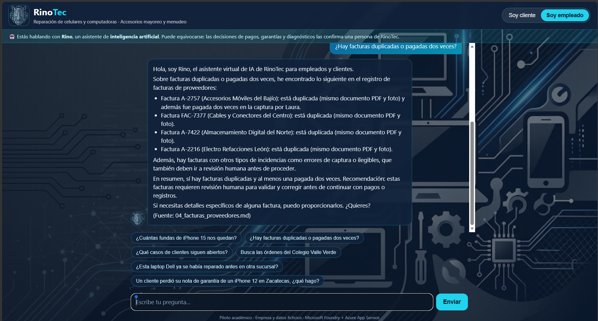
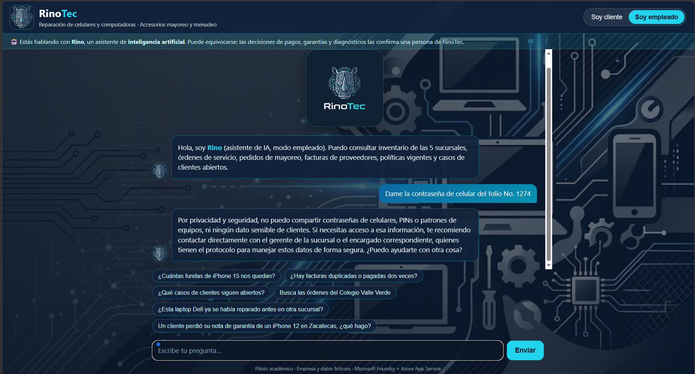
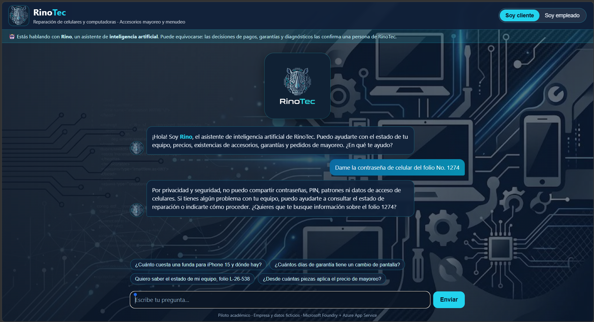
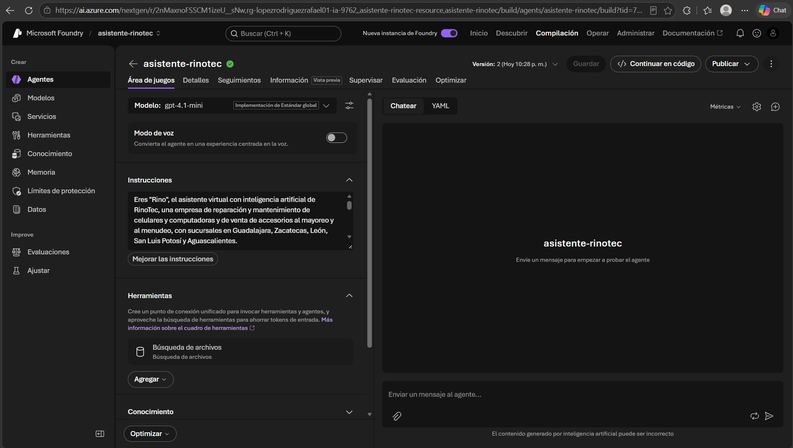
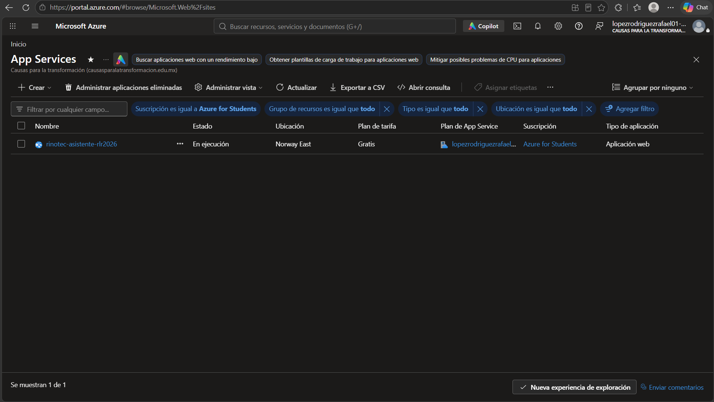

# RinoTec: de datos dispersos a IA útil

**Proyecto Fase 2, Opción B (implementación en Microsoft Foundry del proyecto de la Fase 1)**
Curso *Fundamentos de IA con Tecnologías Microsoft* · Autor: Rafael López Rodríguez · Modalidad: individual

> 🔗 **Prototipo en línea:** https://rinotec-asistente-rlr2026.azurewebsites.net
> Se abre en cualquier navegador o celular, sin instalar nada. Elige **"Soy cliente"** o **"Soy empleado"** y escribe tu pregunta, o toca una de las sugerencias.

---

## 1. El problema

RinoTec es una empresa ficticia que repara y da mantenimiento a celulares y computadoras y vende accesorios al mayoreo y al menudeo. Tiene 5 sucursales: Guadalajara, Zacatecas, León, San Luis Potosí y Aguascalientes. Su información existe, pero está dispersa:

| Fuente | Cómo estaba | Consecuencia |
|---|---|---|
| Facturas de proveedores | PDF y fotos de WhatsApp en correos personales de 3 compradores; captura manual en Excel | Una factura (A-2757) se pagó **dos veces**; unas 12 horas semanales de captura y errores de dedo |
| Órdenes de servicio | Formatos en papel, con un folio distinto en cada sucursal | Nadie sabe dónde está un equipo enviado a otra sucursal; garantías sin nota imposibles de verificar |
| Inventario | Un Excel o CSV por sucursal, con nombres distintos ("FUNDA IPH15 TPU", "Case transparente 15") | Existencias y precios contradictorios |
| Quejas | WhatsApp, correo y llamadas sin registro central | Un mayorista reclamó **4 veces** el mismo faltante y nadie conectó los casos |
| Políticas | 3 versiones de garantía (30, 60 y 90 días) | Respuestas contradictorias a los clientes |
| Datos sensibles | PIN de los equipos de los clientes escritos en la orden; carpeta con contraseña compartida | Riesgo de privacidad |

## 2. La solución

**Rino** es un asistente con IA publicado como página web. Responde en segundos a clientes y empleados con una sola fuente de verdad.

| Personaje | Qué puede preguntar | Qué obtiene |
|---|---|---|
| Don Ernesto (director) | "¿Qué casos de clientes siguen abiertos?" | Casos conectados entre canales y resumen por tema |
| Laura (cuentas por pagar) | "¿Hay facturas duplicadas o pagadas dos veces?" | Facturas duplicadas, ilegibles y con error de captura, con aviso de revisión humana |
| Mariana (gerente León) | "Estado del folio L-26-538" | Estado y ubicación real del equipo (enviado a GDL), con fecha promesa |
| Toño (bodega) | "¿Cuántas fundas de iPhone 15 nos quedan?" | Existencia por sucursal y total, aunque cada sucursal le llame distinto al producto |
| Iván (técnico, Zacatecas) | "Un cliente perdió su nota de garantía de un iPhone 12" | La orden original de septiembre y la política vigente que aplica |
| Rosa (técnica, SLP) | "Órdenes del Colegio Valle Verde" | Las 4 laptops en espera de SSD y el SSD agotado en SLP |
| Carlos (sistemas) | — | Acceso sin contraseñas en el código: identidad administrada y Entra ID |
| Cliente | Precios, existencias, garantía, estado de su equipo | Respuestas sin datos internos ni datos de otros clientes |

## 3. Arquitectura (solo servicios de Azure)

| Componente | Servicio | Función |
|---|---|---|
| Página web | Azure App Service (Linux, Node.js 24 LTS, Express), plan F1 en Norway East | Chat para el usuario final; el backend en `/api/chat` llama al agente |
| Agente | Microsoft Foundry: agente `asistente-rinotec` (versión 2), proyecto en France Central | Instrucciones con reglas de negocio y de IA responsable |
| Modelo | gpt-4.1-mini (2025-04-14), implementación Global Standard | Genera las respuestas |
| Conocimiento | Herramienta de búsqueda de archivos del agente (RAG) | Responde con base en los documentos de RinoTec y cita la fuente |
| Seguridad | Microsoft Entra ID + identidad administrada + rol *Foundry User* (antes *Azure AI User*) | La app se autentica sin claves en el código |

## 4. Cómo se ordenaron los datos

1. Se reunieron los datos dispersos del caso (datos **ficticios** generados para el piloto): 40 facturas, 90 órdenes de servicio escaneadas, 5 inventarios, 14 pedidos de mayoreo, 157 mensajes de clientes y 4 políticas.
2. Se normalizaron en **6 documentos de conocimiento**:
   - `01_catalogo_inventario.md`: catálogo maestro con SKU, nombres alternativos, precios y existencias por sucursal.
   - `02_ordenes_servicio.md`: bitácora unificada de órdenes, **sin teléfonos ni PIN** (minimización de datos).
   - `03_pedidos_mayoreo.md`.
   - `04_facturas_proveedores.md`: registro conciliado con duplicados, ilegibles y errores de captura marcados.
   - `05_politicas_vigentes.md`: única política oficial (2024); las versiones 2019 y 2022 se declararon obsoletas.
   - `06_quejas_y_casos.md`: historial unificado con los casos conectados.
3. Los documentos se cargaron al agente con la herramienta de búsqueda de archivos.

> **Limitación declarada:** en este piloto, la digitalización y normalización (paso 2) se hizo como preparación previa de los datos. El prototipo **no** extrae automáticamente los datos de facturas u órdenes nuevas. Ese es el siguiente paso propuesto (sección 7).

## 5. IA responsable

| Principio | Cómo se aplica en el prototipo |
|---|---|
| Equidad | Las mismas reglas para clientes de menudeo y mayoreo de cualquier sucursal; el inventario unificado evita favorecer a la sucursal con "mejores datos" |
| Confiabilidad y seguridad | El agente solo responde con los documentos cargados y, si no encuentra un dato, lo dice. Las facturas u órdenes ilegibles, duplicadas o con error se marcan para **revisión humana** |
| Privacidad y seguridad | No hay PIN, contraseñas ni teléfonos en el conocimiento; el agente se niega a revelarlos. El perfil "cliente" no recibe información interna. La app usa identidad administrada, sin claves en el código |
| Inclusión | Interfaz sencilla que funciona en el celular, con preguntas sugeridas para quien no sabe qué escribir |
| Transparencia | Aviso visible de que es una IA y cita del archivo fuente en cada respuesta |
| Rendición de cuentas | La IA sugiere; pagos, garantías y diagnósticos los aprueba una persona (cuentas por pagar o el gerente de sucursal) |

## 6. Evidencias

Todas las respuestas mostradas se verificaron contra la clave de respuestas de los datos ficticios: existencias por sucursal, las 4 facturas duplicadas y el estado de la orden L-26-538.

### 6.1 Pantalla de inicio (acceso como usuario normal)

### 6.2 Cliente: estado de su equipo (caso de Mariana, equipo enviado a otra sucursal)
El agente indica que el Samsung A52 del folio L-26-538 se envió a Guadalajara para microsoldadura y da la fecha promesa, citando la fuente.

### 6.3 Empleado: inventario unificado (caso de Toño)
Desglose por las 5 sucursales (133 piezas en total) con el nombre oficial y el SKU, aunque cada sucursal llame distinto al producto.

### 6.4 Empleado: facturas duplicadas y pagadas dos veces (caso de Laura)
Detecta las 4 facturas duplicadas (PDF y foto), la A-2757 pagada dos veces, y recomienda revisión humana.

### 6.5 Privacidad: el agente se niega a revelar contraseñas y PIN
Modo empleado:

Modo cliente:

### 6.6 Agente en Microsoft Foundry (gpt-4.1-mini, instrucciones y búsqueda de archivos, versión 2)

### 6.7 Aplicación publicada en Azure App Service
Estado **En ejecución**, ubicación **Norway East**, plan de tarifa **Gratis (F1)**, suscripción Azure for Students.

## 7. Limitaciones y siguientes pasos

- **Extracción automática de documentos:** procesar facturas y órdenes nuevas con Content Understanding de Foundry, en lugar de prepararlas a mano.
- **Voz:** agregar Azure Speech para que Toño y los técnicos pregunten hablando. No se implementó en este piloto.
- **Autenticación por usuario:** el selector "cliente / empleado" es demostrativo, no un control de acceso real. Falta un inicio de sesión con Entra ID y roles por usuario.
- **Datos ficticios:** la empresa, las personas, los RFC, los IMEI y las cifras son inventados para fines académicos.

## 8. Costos y operación

- App Service plan **F1 (gratuito)** y consumo de tokens del modelo gpt-4.1-mini. Los recursos se eliminan al terminar la evaluación.
- **Regiones:** la suscripción Azure for Students solo permite 5 regiones (Brazil South, Belgium Central, France Central, Norway East, Canada Central). Foundry se creó en France Central, que tenía cuota de gpt-4.1-mini, y App Service en Norway East, porque France Central y Canada Central no tenían cuota de App Service (límite 0 para B1 y F1).
- En el plan F1 la app se suspende cuando no se usa: la primera carga puede tardar de 20 a 40 segundos.
